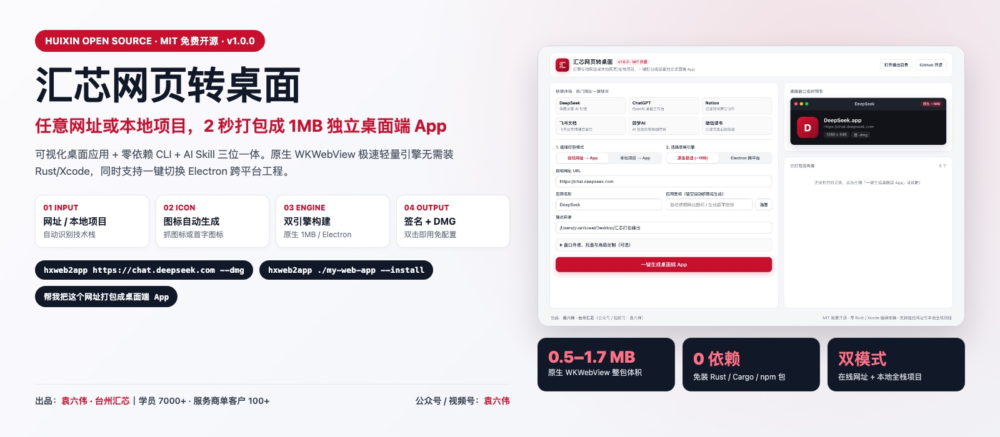
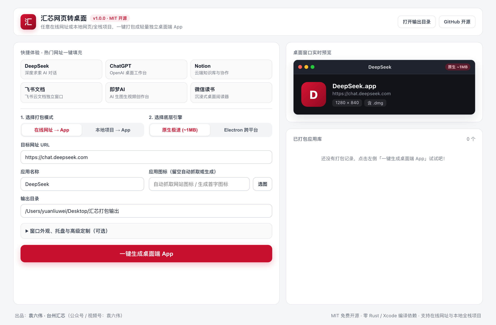
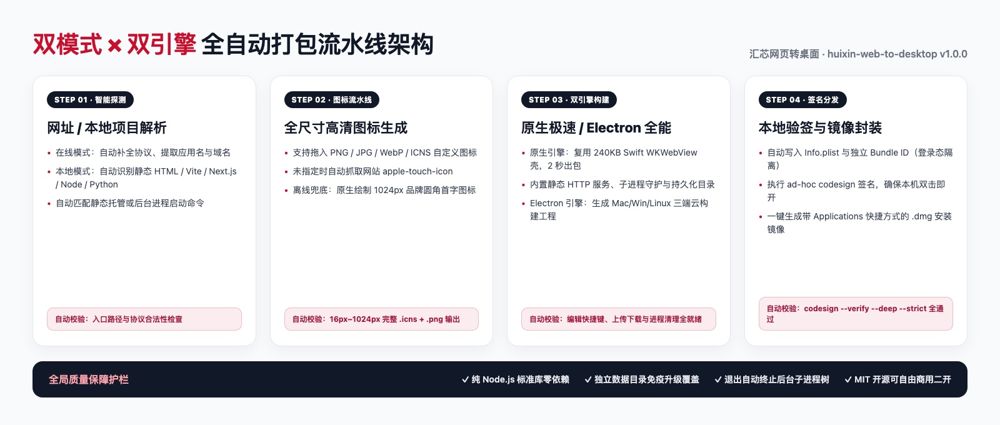

<div align="center">



# 汇芯网页转桌面

### `huixin-web-to-desktop` · 一键将任意在线网址或本地网页/全栈项目，打包成 ~1MB 独立轻量桌面端 App


> **当前版本**：`v1.0.0`（2026-11-24）· 详见 [CHANGELOG.md](CHANGELOG.md)  
> 🔴 **作者：袁六伟 · 台州汇芯**｜一人 AI 公司创业者，学员 7000+，服务商单客户 100+（覆盖近 20 个行业），得到 / 华为分享老师  
> 📮 更多 AI 工具实测与自动化实战，关注 **公众号 / 视频号：袁六伟**

```bash
# 方式 1：作为 AI Skill 一键安装（支持 Cursor / WorkBuddy / Antigravity / Claude Code）
npx skills add sixwei2025/huixin-web-to-desktop

# 方式 2：克隆仓库直接使用（纯 Node.js 标准库，零 npm install 依赖！）
git clone https://github.com/sixwei2025/huixin-web-to-desktop.git
cd huixin-web-to-desktop && node bin/hxweb2app.mjs gui
```

[新手发给 AI 安装](#-新手安装把链接发给-ai) · [对比 Pake 优势](#-一为什么做汇芯网页转桌面对比-pake) · [可视化桌面端](#-二可视化桌面端--一句话快速开始) · [双引擎架构](#-三双模式--双引擎架构拆解) · [避坑细节](#-四高频翻车点根治方案) · [开源矩阵](#-关于作者与同系列开源矩阵)

</div>

---

## 🚀 新手安装：把链接发给 AI

如果你不想研究命令行，直接打开 **WorkBuddy、Codex、Antigravity** 或其他支持读取仓库并安装技能的 AI 智能体，把下面这段话发到对话框，让它帮你安装配套 AI Skill：

```text
帮我安装这个仓库里的技能：
https://github.com/sixwei2025/huixin-web-to-desktop
```

安装完成后，可以直接问它：
> 「这个技能怎么用？帮我把 https://chat.deepseek.com 打包成一个 Mac 桌面端 App。」

> **说明**：
> - 以上步骤安装的是 **AI Skill**，适用于能读取仓库、操作本地文件并支持技能安装的 AI 工具（本机需具备 Node.js >= 18）。
> - 如果你想直接点鼠标使用**可视化桌面端软件（`汇芯网页转桌面.app`）**，请前往本仓库 [Releases 页面](https://github.com/sixwei2025/huixin-web-to-desktop/releases) 下载 `.dmg` 安装镜像，或在本地运行 `npm run build:app` 一键自举构建（安装 Skill 不等于已安装桌面应用）。

---

## 一、为什么做「汇芯网页转桌面」？（对比 Pake）

市面上已有优秀的开源项目 [Pake](https://github.com/tw93/Pake)（在此向 Pake 的设计灵感致敬），但在 **AI 编程（Vibe Coding）时代**，普通用户和一人公司创作者在把网页工具变成桌面端 App 时，依然有 4 个高频痛点：

| 对比维度 | 传统命令行打包工具（如 Pake） | 汇芯网页转桌面（`huixin-web-to-desktop`） |
| :--- | :--- | :--- |
| **使用门槛** | 纯命令行，本机通常需安装 Rust / Cargo / Xcode 工具链，首次编译耗时长、非程序员易劝退 | **可视化桌面端 APP + CLI + AI Skill 三位一体**：点鼠标填网址/选目录，2–5 秒直接出 `.app` 与 `.dmg` |
| **本地项目打包** | 主要面向套壳**远程 URL**，不管本地前后端项目启动与守护 | **双模式通吃**：既支持在线网址，也支持把 **HTML / Vite / Next.js / Node / Python（FastAPI/Flask/Streamlit）** 本地项目连同后台服务守护、空闲端口分配、持久化数据目录一键封装 |
| **包体与速度** | Tauri 约 5–10 MB；Electron 单包约 100–130 MB | **原生 WKWebView 轻量壳（仅 240 KB 二进制）**：实测在线网址版仅 **0.51 MB**、本地应用 **1.3–1.7 MB**，复用预编译壳 **2 秒出包**，零 Rust / npm 依赖 |
| **跨平台扩展** | 跨平台构建需配置多端 Rust 环境 | **双引擎自由切换**：Mac 日常用原生极速引擎；需要 Windows `.exe` / Linux `.AppImage` 时一键切 **Electron 跨平台引擎**（自动附带 GitHub Actions 三端云打包模板） |

---

## 二、可视化桌面端 & 一句话快速开始

### 1. 可视化桌面端工作台实拍（自举打包，整包仅 1.67 MB）



支持 **6 个热门网址一键填充**（DeepSeek、ChatGPT、Notion、飞书文档、即梦 AI、微信读书）、原生文件/图标选择弹窗、实时桌面窗口预览、一键生成 `.dmg` 与历史应用管理。

### 2. 对 AI 说一句话自动打包

| 你对 AI 说的话 | 自动执行的流水线动作 |
| :--- | :--- |
| 「把 DeepSeek 网页版打包成桌面端 App，带上托盘和 dmg」 | 自动抓取图标 → 写入独立 Bundle ID 配置 → 封装 0.5 MB 原生 `.app` + `.dmg` → 完成本地签名 |
| 「把我桌面这个 Vite / HTML 文件夹打包成独立桌面软件」 | 智能探测静态构建目录 → 内置原生 HTTP 服务封装 → 2 秒输出离线可运行的独立 `.app` |
| 「把我这个 Python FastAPI / Node 本地工作台打包成桌面 App」 | 探测启动命令 → 配置空闲端口注入与持久化数据目录 → 封装后台进程守护壳 → 退出自动清理子进程 |
| 「给我生成一个能打包 Windows 和 Linux 的 Electron 跨平台工程」 | 切换 Electron 引擎 → 生成 `main.cjs` + `package.json` + `.github/workflows/build-desktop.yml` 三端云构建配置 |

### 3. CLI 命令行极速用法（零 `npm install` 依赖）

```bash
# 1. 启动可视化桌面工作台
node bin/hxweb2app.mjs gui

# 2. 在线网址秒变桌面 App（自动抓图标 + 生成 .dmg + 立即打开）
node bin/hxweb2app.mjs https://chat.deepseek.com --name DeepSeek --dmg --open

# 3. 本地网页/全栈项目一键封装桌面 App（自动识别 HTML/Vite/Next.js/Node/Python）
node bin/hxweb2app.mjs ./my-web-project --name 我的工作台 --install

# 4. 切换 Electron 跨平台引擎（生成 Mac / Win / Linux 完整工程 + GitHub Actions 云打包）
node bin/hxweb2app.mjs https://www.notion.so --name Notion --engine electron

# 5. 自举打包「汇芯网页转桌面.app」并安装到 /Applications
node gui/build-studio-app.mjs --install
```

---

## 三、双模式 × 双引擎架构拆解



| 步骤 | 核心模块 | 关键处理逻辑 | 自动质检与保障 |
| :--- | :--- | :--- | :--- |
| **Step 01** | `core/detect.mjs` | 区分在线 URL 与本地目录；智能识别 `Next.js standalone`、`Vite/React dist`、纯静态 HTML、`Node.js`、`Python FastAPI/Flask/Streamlit` | 自动校验路径合法性与入口文件存在性 |
| **Step 02** | `core/icon.mjs` | 支持自定义 PNG/JPG/ICNS；未指定时自动抓取网站 `apple-touch-icon` / `favicon`；离线兜底调用原生 CoreGraphics 绘制 1024px 汇芯质感圆角首字图标 | 校验生成全尺寸 `16px–1024px` `.icns` 与 `1024px` `.png` |
| **Step 03** | `core/native-engine.mjs`<br>`core/electron-engine.mjs` | **原生引擎**复用预编译 240KB Swift `WebShell.bin`（内置 `Network.framework` 静态服务器 + 全栈子进程守护）；**Electron 引擎**输出独立 Partition 跨平台工程与云打包工作流 | 完整注册编辑菜单快捷键、文件上传下载与子进程组清理 |
| **Step 04** | `core/packer.mjs` | 写入 `Info.plist` 与独立 Bundle ID，执行本地 `codesign` 签名，可选调用 `hdiutil` 生成带 `/Applications` 软链的 `.dmg` 安装镜像 | 实测通过 `codesign --verify --deep --strict` 严格验签 |

---

## 四、高频翻车点根治方案

很多自己写或者网上找的简易 WebView 套壳工具，用起来经常翻车，我们在底层一次性做了 5 项根治：

1. **根治「无法 Cmd+C / Cmd+V 复制粘贴」**：在原生 Swift `WebShell.swift` 中完整注册系统 `Edit` 菜单（撤销/重做/剪切/拷贝/粘贴/全选）以及 `Cmd+R` 刷新、`Cmd+[ / ]` 前进后退、`Cmd+ / - / 0` 缩放，彻底像原生软件一样顺手。
2. **根治「网页点上传文件没反应、下载文件没动静」**：完整实现 `WKUIDelegate.runOpenPanelWith` 原生文件选择弹窗、JS `alert/confirm/prompt` 原生弹窗以及 `WKDownloadDelegate` 自动保存到 `~/Downloads` 并在 Finder 高亮定位。
3. **根治「本地全栈项目关掉窗口后后台进程残留占端口」**：每次启动通过 POSIX `bind(0)` 动态分配空闲端口并注入 `PORT` / `HUIXIN_PORT`，退出 App 时对整个子进程组发送 `SIGTERM`（`kill(-pgid, SIGTERM)`），绝不留僵尸进程。
4. **根治「升级覆盖 .app 后本地数据丢失」**：为每个应用按独立 `bundleId` 分配系统持久化数据目录（`~/Library/Application Support/<bundleId>`）并注入 `HUIXIN_DATA_DIR` / `DATA_DIR`，覆盖安装新版 `.app` 数据丝毫不丢。
5. **根治「首次打包要装几个 G 的 Rust / Xcode 工具链」**：仓库内置预编译 240KB 原生壳模板 + 纯 Node.js 标准库脚本，无需 `npm install`、无需安装 Rust/Cargo，普通人下载即用。

---

## 五、仓库目录结构与诚实边界

```text
huixin-web-to-desktop/
├── README.md                          # 项目说明与快速上手
├── CHANGELOG.md                       # 版本演进记录
├── LICENSE                            # MIT 开源协议
├── SKILL.md                           # 标准 AI Agent Skill（支持 npx skills add）
├── package.json                       # CLI 入口定义（零第三方依赖）
├── bin/
│   └── hxweb2app.mjs                  # CLI 命令行主入口
├── core/
│   ├── packer.mjs                     # 统一双引擎打包调度器
│   ├── detect.mjs                     # 本地网页/全栈项目智能探测器
│   ├── icon.mjs                       # 图标抓取、自动生成与 .icns 转换
│   ├── native-engine.mjs              # macOS 原生 WKWebView 极速打包引擎
│   ├── electron-engine.mjs            # Electron 全能跨平台工程生成器
│   └── history.mjs                    # 已打包应用历史库管理
├── templates/
│   └── native-macos/
│       ├── WebShell.swift             # macOS 原生 Swift + WKWebView 壳源码
│       ├── WebShell.bin               # 预编译 240KB 原生轻量壳二进制
│       └── build_shell.sh             # 本机重新编译壳脚本
├── gui/
│   ├── server.mjs                     # 零依赖本地可视化工作台控制面
│   ├── public/                        # 可视化前端（index.html / style.css / app.js）
│   └── build-studio-app.mjs           # 自举打包「汇芯网页转桌面.app」脚本
├── scripts/
│   └── verify_self.mjs                # 4 大场景端到端真机验收脚本
└── assets/showcase/                   # 品牌视觉头图、架构图与实拍界面图
```

### 诚实边界与安全说明
- **原生轻量引擎平台支持**：`--engine native` 基于 macOS 系统自带 `WKWebView` 与 `Network.framework`，当前适用于 macOS 12+；Windows / Linux 用户请使用 `--engine electron` 跨平台引擎（或利用自动生成的 GitHub Actions 工作流云端免费出包）。
- **本地签名提示**：打包生成的 `.app` 使用本地 ad-hoc 签名，在本机可直接双击打开；若跨电脑分发给他人，对方首次打开在系统提示时右键选择「打开」或在「隐私与安全性」中点击「仍要打开」即可。
- **开源致敬**：设计理念参考了 [tw93/Pake](https://github.com/tw93/Pake)，底层原生 Swift 壳、双引擎打包核心与可视化桌面端均为完全自研（MIT 协议开源）。

---

## 关于作者与同系列开源矩阵

- **作者**：**袁六伟 · 台州汇芯**（一人 AI 公司创业者，学员 7000+，服务商单客户 100+，覆盖近 20 个行业，得到 / 华为分享老师）
- **公众号 / 视频号**：搜 **「袁六伟」**，获取更多 AI 效率工具、自动化工作流与一人公司实战复盘
- **GitHub 主页**：[https://github.com/sixwei2025](https://github.com/sixwei2025)

| 开源仓库 | 核心定位 | 协议 |
| :--- | :--- | :--- |
| **[huixin-web-to-desktop](https://github.com/sixwei2025/huixin-web-to-desktop)** | **汇芯网页转桌面**：在线网址 / 本地项目一键打包 ~1MB 独立桌面端 App | MIT |
| [huixin-token-manager](https://github.com/sixwei2025/huixin-token-manager) | 汇芯 Token 管家：macOS 菜单栏实时监控多平台 AI 额度与消耗预测 | MIT |
| [huixin-skills-manager](https://github.com/sixwei2025/huixin-skills-manager) | 汇芯技能管家：一键同步与管理全平台 AI Agent Skills | MIT |
| [huixin-agent-hub](https://github.com/sixwei2025/huixin-agent-hub) | 汇芯智能体中台：多智能体协作与任务交付调度工作台 | MIT |
| [everyone-can-build-skills](https://github.com/sixwei2025/everyone-can-build-skills) | 人人都能做 Skill：零基础构建生产级 Agent Skill 实战指南 | MIT |
| [workbuddy-wechat-autopilot](https://github.com/sixwei2025/workbuddy-wechat-autopilot) | 公众号全自动写作、排版与草稿箱投递流水线 | MIT |
| [talking-head-video-skill](https://github.com/sixwei2025/talking-head-video-skill) | 口播短视频自动粗剪、字幕与动效包装流水线 | MIT |
| [trending-news-video-skill](https://github.com/sixwei2025/trending-news-video-skill) | AI 热点新闻短视频全自动抓取与渲染引擎 | MIT |
| [auto-tutorial-skill](https://github.com/sixwei2025/auto-tutorial-skill) | 软件实操自动录屏、缩放运镜与教程视频生成 | MIT |
| [wechat-cover-skill](https://github.com/sixwei2025/wechat-cover-skill) | 杂志风公众号多风格封面自动渲染引擎 | MIT |
